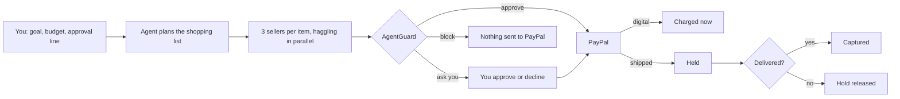

# Infinity Bazaar ∞

**Your AI haggles. Your rules guard the money.**

Give an AI shopping agent a goal and a budget. It picks what to buy, haggles with three AI sellers at once, catches their tricks, and pays through **real PayPal**. Before any money moves, **AgentGuard** checks every payment against your rules. AgentGuard is plain code, so a smooth-talking seller can't argue its way past it.

**Live demo:** https://infinity-bazaar.vercel.app

Built for the PayPal AI Hackathon 2026.

## Try it in two minutes

1. Press **Play**. Your agent haggles with three sellers side by side, in one-on-one chats you can read, while a live commentator calls the tactics.
2. Type **1** or **7** in **Table** and press Enter. A purchase goes over your $100 approval line, so the agent stops and asks you first.
3. Press **Agent goes rogue**. A pushy seller talks the agent into a $140 bundle on a $70 limit. The agent says yes; AgentGuard says no. **Nothing is sent to PayPal.**
4. Switch on **PayPal sandbox (test money)** and play **Web font license** or **USB microphone**. A real PayPal window opens. Approve with a sandbox buyer account, then tick **Show PayPal details** to see the real order id.

Every table is seeded: **the same table number always replays the same deal**.

## What makes it different

- **Real negotiation, not a script.** Each seller has a hidden lowest price, a personality and its own tricks, such as fake deadlines, made-up rival buyers, hidden fees, teaser prices and upsells. The agent:
  - anchors just under the market low
  - knows its walk-away price
  - raises its offer in shrinking steps
  - plays sellers against each other
  - asks about fees before agreeing
  - compares the true cost, including fees now and later costs such as renewals
  - trades for extras instead of paying more
  - walks away when nobody meets its price
- **The AI never has the final say on money.** AgentGuard answers **Approve**, **Ask you** or **Block** for every payment. It checks:
  - the item limit and your total budget
  - the agreed price and the seller
  - surprise checkout fees and later costs
  - your approval line and your safety reserve

  It runs on screen, then again on the server just before PayPal.
- **Pay on delivery for physical goods.**
  - Digital items are charged straight away.
  - Shipped goods and services are **held** with a PayPal authorization and **captured when delivered**.
  - If delivery fails, the hold is **voided** and nothing is charged.
- **Built to be trusted:**
  - The browser can never choose an amount.
  - A retry can never charge twice.
  - An edited or replayed payment record can't sneak past the budget.
- **Live AI voices, with the numbers locked.** With a Claude API key set, Claude rewrites the chat lines of each deal in character: the pushy upseller flatters, the stubborn veteran grumbles, the commentator calls it like a sports match. The engine still decides every price, move and outcome. Each rewritten line must keep exactly the dollar amounts of the original and add none, checked in code; any line that fails, and any slow or failed call, plays the original text instead. "Show original lines" switches back at any time.

## Proof: real PayPal sandbox payments

These purchases were made on the live site through PayPal's checkout window, approved by a sandbox buyer, then read back from PayPal's API:

| Purchase | Amount | PayPal order | PayPal's record |
|---|---|---|---|
| Web font license (digital) | $36.00 | `6NL44467DN736822G` | Capture COMPLETED |
| USB microphone, delivered | $43.00 | `5S816938611020847` | Authorization CAPTURED on delivery |
| USB microphone, delivery failed | $43.00 | `14R5643610878250W` | Authorization VOIDED, nothing charged |
| Font license paid from a connected wallet (no PayPal window) | $36.00 | `62U44338A4536814D` | Capture COMPLETED (Vault) |
| Buyer pressed Cancel in PayPal | $36.00 | `4TP06960GM1183607` | Never approved, nothing charged |

A full 3-item mission with one "ask you" approval was also paid end to end. PayPal's captured total matched the receipt ($71).

## How a mission works



## How payments work

The browser never sends a price. It only names the run (mission, table number, and a random id for each Play) and the line to pay. The server then:
1. replays the deterministic engine and works out the amount itself;
2. runs AgentGuard again;
3. only then calls PayPal.

| AgentGuard says | What happens at PayPal |
|---|---|
| Approve | Paid from your connected PayPal wallet (Vault v3) with no one present, or you approve it in a PayPal window |
| Ask you | You approve in the deal room, then in PayPal |
| Block | No call to PayPal at all |

**PayPal APIs used:**
- Orders v2 with CAPTURE for digital goods.
- Orders v2 with AUTHORIZE for shipped goods, then capture on delivery or void if delivery fails.
- Vault v3 setup and payment tokens for the connected wallet, charged with merchant-initiated stored credentials.

**Safety details:**
- **No double charges.** Each line has a stable `PayPal-Request-Id` and `invoice_id`, so a retry or double click returns the same order instead of paying twice.
- **Recovery after a lost reply.** If PayPal already finished a step (already captured, already voided, duplicate invoice), the server reads PayPal's state and records it.
- **Declined payments.** Declined funding sends the buyer back to PayPal. A declined saved wallet falls back to approval in a PayPal window.
- **Payments under review.** These show as "Waiting for PayPal", never "Paid". A hold under review is never captured early.
- **Timeouts and retries.** Every PayPal call times out after 10 seconds. It is retried once with the same request id, after a pause on a 429 or 5xx.
- **Tamper-evident payment record.** The ledger travels with the browser, signed with an HMAC. The server counts every earlier purchase as spent unless the signed ledger proves no money moved, so an old or missing ledger can't hide spending.
- **Strict payment routes.** They accept only same-site JSON. Errors shown in the browser are short and carry PayPal's debug id; details stay in the server log.

## Run it

Requires Node.js 22.18 or newer.

```bash
npm install
npm run dev           # http://localhost:3000, demo mode with simulated payments
```

For real PayPal sandbox payments, copy `.env.example` to `.env.local` and fill in `PAYPAL_CLIENT_ID` and `PAYPAL_CLIENT_SECRET` from a sandbox app linked to a **US** sandbox business account.

```bash
npm run demo          # a full "hackathon in 10 days, $300" mission in the terminal
npm run demo:rogue    # the agent falls for an upsell; AgentGuard blocks it
npm test              # engine, negotiation, playback and payment tests
npm run e2e           # browser checks of the deal room (needs `npx next start -p 3100`)
npm run e2e:paypal    # real PayPal sandbox purchases (needs a sandbox buyer login)
```

CI runs on every push. It checks the data and types, runs the unit tests, makes a production build, and plays the deal room in a real browser.

## What's in the repo

| Path | What it is |
|---|---|
| `data/` | 40 catalog items with researched prices and sources, 10 seller personalities, random events, 3 missions and the dialogue library |
| `src/engine/` | Negotiation engine, AgentGuard and mission runner: pure, seeded TypeScript, so any run replays exactly |
| `lib/timeline.ts` | Turns engine results into the step-by-step playback |
| `lib/server/` | PayPal client, signed ledger, payment service and request checks |
| `app/api/` | Payment routes (pay, complete, decline, deliver) and wallet connect |
| `components/` | The deal room: arena, booths, AgentGuard gate, payment panel and receipt |
| `tests/` | Unit tests, plus browser tests in `tests/e2e/` |

## License

MIT
