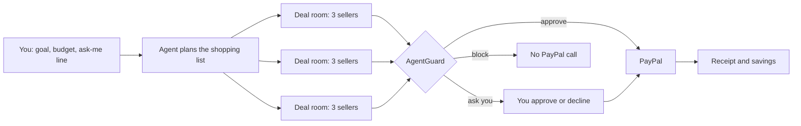

# Infinity Bazaar ∞

Give an AI agent a goal and a budget. It picks what to buy from a catalog, negotiates with three AI sellers at once, plays them against each other, and pays through PayPal. **AgentGuard**, plain code rather than AI, checks every payment against the rules you set before any money can move.

Built for the PayPal AI Hackathon 2026.

## Run it

Requires Node.js 22.18 or newer. No API keys are needed for the current version.

```bash
npm install
npm run dev           # deal room at http://localhost:3000
```

```bash
npm run demo          # a full "hackathon in 10 days, $300" mission in the terminal
npm run demo:rogue    # the agent falls for an upsell; AgentGuard blocks it
npm test              # engine, negotiation-quality and playback tests
npm run e2e           # real-browser checks (needs Playwright and `npx next start -p 3100` running)
```

## How a mission works



1. **Plan.** Each mission comes with a shopping list from the catalog and a cap for each item.
2. **Negotiate.** For each item, three randomized sellers with hidden lowest prices and their own tactics negotiate in parallel. The agent:
   - anchors just under the web low
   - knows its walk-away price
   - raises its offer in shrinking steps
   - uses one seller's offer as leverage against the others
   - checks for hidden fees and trades for extras instead of paying more
   - flags tricks such as fake urgency
3. **Guard.** AgentGuard checks the item cap, the total budget and the seller, and asks you before any payment above your ask-me line.
4. **Pay.** Digital goods are paid immediately. Shipped goods and services are authorized now and captured on delivery (a PayPal authorization is honoured for 3 days and valid for up to 29). A failed delivery voids the hold, so no money moves.

## What's in the repo

| Path | What it is |
| --- | --- |
| `data/` | Catalog of 40 items, 10 seller personalities, 10 random events, 3 missions |
| `src/engine/` | Negotiation engine, AgentGuard and mission runner: pure TypeScript and seeded, so any run replays exactly |
| `lib/timeline.ts` | Turns engine results into the step-by-step playback the deal room shows |
| `components/DealRoom.tsx`, `app/` | The Next.js deal room |
| `tests/` | Engine, negotiation-quality and playback tests, plus a Playwright end-to-end script in `tests/e2e/` |

## Status

| Part | State |
| --- | --- |
| Catalog, negotiation engine, AgentGuard | Done, tested |
| Deal room web app | Working; arena redesign in progress |
| PayPal sandbox (Orders v2: capture, authorize, capture on delivery, void; Vault v3 wallet) | Working: real sandbox orders when keys are set, simulated otherwise |
| AI voices for sellers | Planned. The engine decides every price; the AI only rewrites the wording |

Catalog prices are hand-researched estimates (`confidence: "estimate"`), not live data.

## How payments work

The browser never sends a price. It names the run (mission, table number and a random id for each Play) and the line; the server replays the deterministic engine, computes the amount itself, runs AgentGuard, and only then calls PayPal.

| AgentGuard says | What happens at PayPal |
| --- | --- |
| Approve | Paid from your connected PayPal wallet (Vault), with no one present. Without a wallet, you approve it in a PayPal window. |
| Ask you | You approve in the deal room, then in the PayPal window. |
| Block | No call to PayPal at all. |

Digital items use intent CAPTURE. Shipped goods and services use intent AUTHORIZE: the money is held, captured when delivery is confirmed, or the hold is voided if delivery fails. PayPal's own capture and authorization statuses are checked; anything but success counts as declined.

Every PayPal call carries a `PayPal-Request-Id` derived from the run's random id and the line, so a retry or double click returns the same order instead of paying twice, and two visitors never share ids.

The payment ledger travels with the browser, signed by the server. It is tamper-evident: amounts, states and the run can't be changed. An older copy of the same run's ledger could be replayed, so the budget is enforced per run; per-line request ids still prevent paying any line twice. A production version would keep the ledger in a database.

## License

MIT
